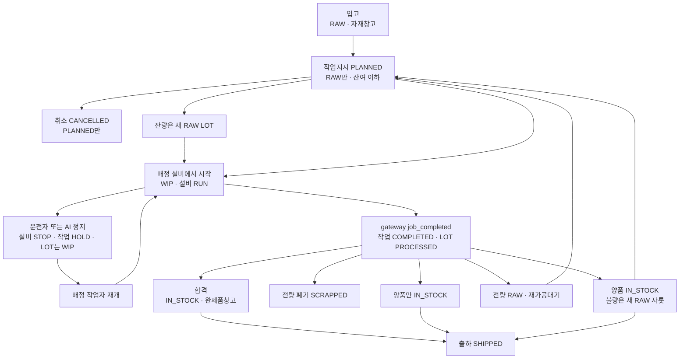
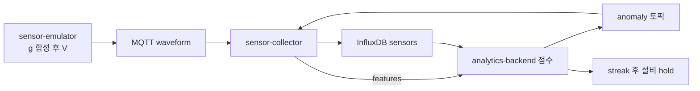

# MES-AI 프로세스와 로드맵

지금 코드와 매니페스트에 있는 공장 MES와 진동 분석만 적는다. 날짜는 정하지 않는다.

로컬 클러스터 이름은 `factory-mes`다. 밖으로 열리는 주소는 Nginx TLS뿐이다.

- MES 화면: https://localhost:13000 와 https://localhost:8443
- 센서 분석: https://localhost:13001

## 목차

1. [구현된 프로세스](#구현된-프로세스)
2. [시스템 역할](#시스템-역할)
3. [다음 단계 로드맵](#다음-단계-로드맵)

## 구현된 프로세스

### 입고부터 출하

입고는 검사 없이 `RAW` LOT를 자재창고에 둔다. 작업지시는 `RAW`만 연결하고, 수량은 그 LOT에 이미 걸린 대기 지시를 뺀 잔여를 넘지 못한다. 취소는 `PLANNED`만 되고 행은 남는다.

시작은 그 작업지시의 설비에 배정된 작업자만 한다. 잔량이 있으면 잔량은 새 `RAW` 자재창고 LOT로 갈라지고, 시작분 수량이 가공으로 들어간다. LOT는 `WIP`, 위치는 설비 이름, 설비는 `RUN`, 작업지시는 `IN_PROGRESS`다.

운전자의 정지와 재개는 배정된 설비만 된다. 정지하면 설비는 `STOP`, 작업지시는 `HOLD`, LOT는 `WIP`로 남는다. 재개는 `STOP`인 설비의 일시정지 작업만 다시 `IN_PROGRESS`로 돌린다. 분석 백엔드의 정지는 설비 코드와 `X-Internal-Token`으로 같은 정지 함수를 호출한다.

게이트웨이가 `job_completed`를 보내면, 작업이 `IN_PROGRESS`일 때만 작업지시는 `COMPLETED`, LOT는 `PROCESSED`, 위치는 검사대기장, 설비는 `IDLE`이 된다. 정지 중인 작업은 이 완료를 받지 않는다.

품질 판정은 `PROCESSED`만 받는다. 품목에 등록된 기준마다 실측을 넣고, 공차 밖 개수 중 최댓값이 불량 수량이다. 양품은 생산 수량에서 그 불량을 뺀 값이다. 불량이 없는데 재가공이나 폐기를 고르면 거절된다.

- 합격: `IN_STOCK`, 완제품창고.
- 전량 폐기: `SCRAPPED`, 위치 폐기.
- 부분 폐기: 양품 수량만 같은 LOT에 `IN_STOCK`, 완제품창고.
- 전량 재가공: 같은 LOT가 `RAW`, 재가공대기.
- 부분 재가공: 양품은 `IN_STOCK` 완제품창고, 불량 수량은 새 `RAW` LOT로 재가공대기.

출하는 `IN_STOCK`만 된다. 출하 번호는 `SHP-`로 시작하고 LOT는 `SHIPPED`, 위치는 출하완료다.

### 진동과 판정

가공 제어와 파형은 길이 다르다. 설비 에뮬레이터는 스칼라 센서를 MQTT `sensors`로 보낸다. PLC 상태 MQTT `state`는 게이트웨이가 Modbus로 읽어 게시한다. PIEZO 파형은 센서 에뮬레이터가 만든다.

센서 에뮬레이터는 MES 센서 목록을 `X-Internal-Token`으로 읽고, 가속도 g로 합성한 뒤 100 mV/g를 곱한 전압으로 `waveform`에 게시한다. 시드 PIEZO의 기본 주기는 3600초다. 같은 시각의 프리셋은 `mes/sim/{code}/labels`로 보낸다.

수집기는 MQTT를 받아 Influx에 `waveform`, `features`, `scalar`, `label`을 쓰고, 분석이 올린 판정은 `anomaly`로 남긴다. 특징값은 RMS, peak, crest, kurtosis, 1x, 2x이고 `features` 토픽으로 다시 낸다.

분석 백엔드는 실시간 적용이 켜진 모델만 점수를 내고 `anomaly` 토픽에 올린다. 같은 설비·모델에서 이상이 `anomaly_streak`(기본 3)까지 연속되고, 그 설비의 이전 정지 호출 뒤 120초가 지났으면 내부 토큰으로 설비를 정지한다.

실시간 화면의 최신 블록은 수집기가 최근 26시간 창에서 고른 마지막 파형이다. 이력은 설비·센서·최대 8일 기간으로 찾고 한 번에 200건까지다. 고른 블록의 시각만 이름 있는 세트에 저장하고 샘플은 Influx에 남긴다.

모델 학습은 최근 구간의 수집값이거나 그 세트다. Isolation Forest는 특징값이고 30행 미만이면 학습이 실패한다. SSAD와 HOKO는 선택한 파형이고, 한 세트의 샘플레이트는 같아야 한다. 화면의 `g = V / (mV/g / 1000)` 변환은 표시만 바꾸며 기본 감도는 100 mV/g다. 저장값과 학습 입력은 전압 그대로다. `HokoClassifier`와 사전학습 가중치는 워커가 부르지 않는다.

게이트웨이는 retained `job`을 받기 전에는 Modbus 명령을 보내지 않는다. 목표 작업이 없고 PLC가 돌고 있으면 STOP을 보낸다. 진행 중 수량은 MES가 5초마다 retained job의 `producedQty`로 갱신하고, PLC가 다시 뜨면 MES 수량과 PLC 수량 중 큰 값부터 이어 간다. PLC 상태가 기본 10초 동안 없으면 화면에서는 오프라인이다.

## 시스템 역할

### frontend

Next.js MES 화면이다. 브라우저는 이 화면만 보고, 서버 액션이 `http://backend:8000`으로 호출한다. 로그인 쿠키 `mes_session`은 httpOnly다.

| 직무 | 경로 | 하는 일 |
| --- | --- | --- |
| ADMIN | `/` | 대시보드. LOT 단계 수량, 진행 중 작업, 열린 경보. 직원 `/employees`, 검사 기준 `/inspection-specs`, 추적 `/traceability`, 모니터링 `/monitoring` |
| MATERIAL | `/materials`, `/shipping` | 입고와 출하 |
| PLANNER | `/work-orders` | 작업지시 발행과 시작 전 취소 |
| OPERATOR | `/shop-floor` | 배정 설비의 시작, 정지, 재개 |
| QUALITY | `/quality` | 가공 완료 LOT의 실측과 판정 |

주소는 https://localhost:13000 과 https://localhost:8443 이다. `/monitoring`은 분석 화면으로 보내는 입구이고 파형 차트는 이 앱에 없다.

### backend

FastAPI다. LOT, 작업지시, 설비, 센서, 검사 기준, 인증, MQTT 연결을 맡는다. 데이터는 MariaDB다. AI 정지와 센서 에뮬레이터의 센서 목록은 `X-Internal-Token`으로 구분한다. 센서 추가·변경·삭제는 관리자 세션이다. `AUTH_SECRET`이 공개 기본값이거나 16자 미만이면 프로세스가 뜨지 않는다.

### MariaDB

MES 영속 데이터다. LOT, 작업지시, 설비, 사원, 스칼라 측정, 검사 기준과 실측, 출하, 이력 이벤트가 있다. 파형 샘플은 두지 않는다. 기동 시 `create_all`과 필요한 열 추가로 맞춘다.

### Mosquitto

계정과 ACL로 받고 anonymous는 막는다. 계정은 backend, collector, gateway, machine, waveform, analytics, probe다. 비밀번호는 git 밖 Secret이다.

토픽은 `mes/machines/{code}/{sensors,state,events,job,waveform,features,anomaly}`와 `mes/sim/+/labels`다. `job`은 MES가 retained, QoS 1로 내린다. `state`와 `events`는 게이트웨이가 올린다. `events`의 `job_completed`가 작업 완료다.

### edge-gateway

에뮬레이터 Modbus TCP와 MQTT `job`, `state`, `events`를 잇는다. 로컬에서는 `MACHINE_A=emulator-a:5020`, `MACHINE_B=emulator-b:5020`이다. 작업 메시지가 오기 전에는 PLC에 명령을 쓰지 않는다. 파형은 수집하지 않는다.

### machine-emulator A/B

PLC와 스칼라 센서 에뮬레이터다. `MACHINE_A` 정격 3000 rpm, 사이클 0.6초, 고장 없음. `MACHINE_B` 정격 2400 rpm, 사이클 0.9초, 20초 뒤 `bearing_overheat`. 스칼라는 MQTT `sensors`로 보낸다. `state` 토픽은 게이트웨이가 PLC 레지스터를 읽어 게시한다.

### sensor-emulator

MES 센서 목록을 내부 토큰으로 읽고, g로 합성한 파형을 100 mV/g 전압으로 `waveform`에 게시한다. 기본 주기는 3600초다. 스핀들이 돌면 그 회전수, 멈추면 정격 회전수를 쓴다.

### sensor-collector

MQTT를 받아 Influx에 `waveform`, `features`, `scalar`, `label`을 쓴다. 조회는 최신 파형(26시간 창), 이력 검색(8일, 200건), 시각 하나, features, 파형 SSE다. API 인증은 없다. NetworkPolicy ingress는 analytics-frontend, analytics-backend와, 데이터 경로의 mqtt, influx만 연다.

### InfluxDB 2.7

버킷 `sensors`, retention 168h. 파형 저장 단위는 V다.

### analytics-frontend

실시간 파형 `/`, 파형 이력 `/history`, 센서 연결 `/simulator`, 모델 `/models`. ADMIN만 연다. 주소는 https://localhost:13001 이다. 서버 액션이 collector `8001`, emulator `8002`, analytics `8003`, MES `8000`을 호출한다. 표시 단위 변환은 이 화면 안에서만 한다.

### analytics-backend

SQLite에 모델 카탈로그와 명명 세트(datasets)를 둔다. 세트는 설비, 채널, 시각 참조만 저장하고 샘플은 Influx에 남긴다. Isolation Forest 버전은 MLflow에 두고, SSAD와 HOKO 가중치는 워커가 이 서비스 모델 디렉터리에 둔다. 실시간 점수는 `anomaly_streak`(기본 3) 뒤 내부 토큰으로 설비를 hold한다.

### MLflow

Isolation Forest의 실험과 버전 등록이다. 실시간 점수는 analytics-backend가 한다. 추적 주소는 클러스터 안 `http://mlflow:5000`이다.

### Nginx

유일한 공개 입구다. TLS로 `frontend:3000`과 `analytics-frontend:3001`만 프록시한다. API location은 없다.

### 클러스터

k3d 클러스터 `factory-mes`. Argo CD 자동 동기화는 꺼져 있고, 화면에서 Sync한다. `argocd/application.yaml`의 syncPolicy에는 `automated`, `prune`, `selfHeal: true`가 적혀 있다. Headlamp는 파드와 로그를 보고 `http://localhost:4466`으로 연다. NetworkPolicy가 파드 유입을 제한한다. Secret `mes-data`와 MQTT, TLS 비밀은 git 밖이고 `overlays/k3d/create-secrets.sh`가 클러스터에만 만든다. 파드는 `enableServiceLinks: false`다. k3d 이미지는 `factory-mes/*:local`이고 `imagePullPolicy`는 `IfNotPresent`다.

## 다음 단계 로드맵

아래는 코드에 없는 일이다.

다음 제품 조각은 입고검사다. 입고할 때 측정하고, 불량은 사용 가능한 `RAW`가 되지 않게 한다. 지금 입고는 검사 없이 자재창고 `RAW`다.

그다음은 파형 수집 주기 3600초를 줄이고, 전압 규모 샘플로 모델을 다시 학습하는 일이다. 표시용 g 변환은 학습 입력이 아니다.

인프라 후순위는 Alembic으로 기동 시 `create_all`을 대체하는 일이다. Argo self-heal은 아직 꺼져 있다. 시각 기준, 특채, Prometheus, `HokoClassifier` 연결도 없다.
